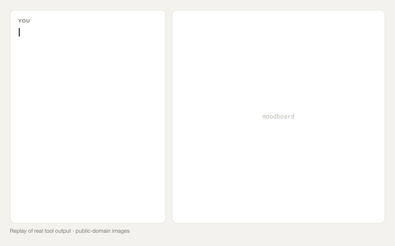

# cosmos-mcp

[](https://www.npmjs.com/package/cosmos-mcp)
[](LICENSE)
[](https://modelcontextprotocol.io/)

cosmos-mcp lets an AI agent build moodboards on [cosmos.so](https://www.cosmos.so), a site for collecting images. It is an unofficial [Model Context Protocol](https://modelcontextprotocol.io/) (MCP) server. MCP is the standard that lets apps such as Claude and Cursor call outside tools. With this server, the agent can search Cosmos, find similar images, and save collections to your account.

Search and browsing work without an account. You sign in only when you want to save.



[](https://cursor.com/en/install-mcp?name=cosmos&config=eyJjb21tYW5kIjoibnB4IiwiYXJncyI6WyIteSIsImNvc21vcy1tY3AiXX0%3D)
[](#install)

To add it to Claude Code, run:

```bash
claude mcp add cosmos -s user -- npx -y cosmos-mcp
```

Then ask: "Show me 8 images of warm brutalist interiors from Cosmos." You can also start the `moodboard` prompt, which Claude Code shows as `/mcp__cosmos__moodboard`.

## Unofficial. Not affiliated with Cosmos.

Read these points before you install:

- Cosmos publishes no API. This server calls the private GraphQL endpoint that the cosmos.so web app uses. Cosmos can change or remove that endpoint at any time. When it does, this server stops working.
- To save, the server uses your own browser session token (the `Authorization` header). There is no OAuth and no limit on scope. The token can do everything that your account can do.
- You must follow the [cosmos.so Terms of Service](https://www.cosmos.so/terms). Use your own account and your own data. Do not scrape.
- You use this server at your own risk, which includes the risk of account restrictions. The [LICENSE](LICENSE) gives no warranty.

## What it does

On Cosmos, people save images, videos and products. Each saved item is an element. A collection is a group of elements, and collections can contain other collections. The Cosmos API calls a collection a "cluster", so the tool names use that word. This page says "collection".

In one turn, an agent can:

1. Search Cosmos for "warm brutalist interiors".
2. Find images that look like the best result.
3. Look at each image and reject the weak ones.
4. Create a collection and save the best images.

You describe what you want, and the agent builds the moodboard. Use it for these tasks:

- Research: find reference images for a brief without clicking through a site.
- Curation: sort saved work into collections and move elements between them.
- Discovery: start from one image that you like and find more like it.

## Install

### Claude Code

Run:

```bash
claude mcp add cosmos -s user -- npx -y cosmos-mcp
```

The `-s user` flag adds the server to every project. Without it, Claude Code adds the server to the current project only.

### Claude Desktop extension

Each [GitHub release](https://github.com/mrmos/cosmos-mcp/releases) has a `cosmos-mcp-<version>.mcpb` file. Open it, and Claude Desktop installs the server. You do not need Node. To save, paste your token into the extension settings.

### Other clients

Other MCP clients use this JSON configuration:

```json
{
  "mcpServers": {
    "cosmos": {
      "command": "npx",
      "args": ["-y", "cosmos-mcp"]
    }
  }
}
```

Put it in one of these files:

- Claude Desktop, without the extension: `claude_desktop_config.json`. On macOS it is in `~/Library/Application Support/Claude/`. On Windows it is in `%APPDATA%\Claude\`. Restart the app after you edit it.
- Cursor: `~/.cursor/mcp.json` for every project, or `.cursor/mcp.json` for one project.
- Claude Code, if you edit the file yourself: `.mcp.json` at your project root. People usually commit this file, so never put a token in it.

This configuration is enough for search and browsing. To save collections, run `npx cosmos-mcp login` one time (see [Authentication](#authentication)). A running server uses the new token on its next tool call. You do not have to restart anything.

### Put the token in the client configuration

If you prefer, give the token to the client instead of using `login`. For Claude Code, put the `-e` flag before the `--`:

```bash
claude mcp add cosmos -s user -e COSMOS_AUTHORIZATION="Bearer <your token>" -- npx -y cosmos-mcp
```

For the JSON configuration, add `"env": { "COSMOS_AUTHORIZATION": "Bearer <your token>" }` next to `args`. Use a real token only. The server reports a placeholder as a rejected token.

### From a local clone

You need [Bun](https://bun.com). Run:

```bash
git clone https://github.com/mrmos/cosmos-mcp.git
cd cosmos-mcp
bun install
claude mcp add cosmos -- bun run /absolute/path/to/cosmos-mcp/index.ts
```

Use absolute paths, because MCP clients do not always resolve relative paths. A local clone reads `.env`, so you can leave `env` out of the client configuration.

## Authentication

You need this section only when you want to save. Every tool that does not need sign-in in the [Tools](#tools) tables works now.

Cosmos has no API keys and no OAuth. The web app signs in with a bearer token in the `Authorization` header. This server uses your token in the same way.

### Sign in

Run:

```bash
npx cosmos-mcp login
```

The command shows you how to copy the token and hides what you type. It tests the token against cosmos.so and saves the token only if it works. A server that is already running uses the new token on its next tool call.

The token goes in `~/.config/cosmos-mcp/config.json`. Only your user account can read this file, and the command never prints the token. To paste the token from a password manager, run `pbpaste | npx cosmos-mcp login`.

```bash
npx cosmos-mcp status    # which credential is in use, and whether it still works
npx cosmos-mcp logout    # remove it
```

To copy the token (`login` prints these steps too):

1. Sign in at [cosmos.so](https://www.cosmos.so).
2. Open DevTools (`Cmd+Option+I` on macOS, `F12` on other systems).
3. In the Network tab, reload the page.
4. Click a request to `api.cosmos.so`.
5. Under Request Headers, copy the full `Authorization` value. It starts with `Bearer `.

Do not copy the `Cookie` header. Its `AWSALB` values only route traffic between servers, and they do not sign you in.

The server looks for a credential in three places, in this order:

1. The `COSMOS_AUTHORIZATION` environment variable, which an MCP client sets in its `env` block.
2. A `.env` file next to the package, for local clones.
3. `~/.config/cosmos-mcp/config.json`, which `login` writes.

The server uses the first place that has a credential, and takes all credential values from that place only.

### Keep the token safe

The token works like a password. Anyone who has it can act as you on Cosmos.

- Do not commit the token to `.mcp.json` or a dotfile repository, and do not show it in a screenshot.
- Do not paste the token into a chat message. The chat saves it in transcripts and sends it to a model provider. Use the `env` block, `.env`, or `login` instead.
- The token expires. When the write tools report "not signed in", run `npx cosmos-mcp login` again.
- To cancel the token, sign out of that browser session on cosmos.so.

The server sends the token to `api.cosmos.so` and to no other host. The server has no telemetry. It writes nothing to disk except the credential file that `login` saves.

Cosmos has a login mutation for passwords, but this server does not use it. With that mutation, your password goes through a third-party tool. Cosmos also limits login attempts and blocks scripted logins. A session token gives less access, and you can cancel it.

### Environment variables

Nothing is required. For a starting file with comments, copy [`.env.example`](.env.example) to `.env`.

| Variable | Default | What it does |
| --- | --- | --- |
| `COSMOS_AUTHORIZATION` | unset | The `Authorization` header value. With it, every tool works. The server adds `Bearer ` to a bare token. |
| `COSMOS_COOKIE` | unset | A full `Cookie` header that carries a session. You rarely need it. The `AWSALB` cookies on a normal request do not sign you in. |
| `COSMOS_USER_ID` | unset | Your numeric Cosmos user id. Optional. With it, the server skips the `me` lookup on first use. |
| `COSMOS_ENDPOINT` | `https://api.cosmos.so/graphql` | The GraphQL endpoint. Change it only for a mock or a proxy. |
| `COSMOS_TIMEOUT_MS` | `30000` | The timeout for each request, in milliseconds. The server ignores a value that is not valid and prints a warning. |
| `COSMOS_CLIENT_NAME` | `cosmos-web` | Sent as `x-client-name`. The API rejects unknown clients, so do not change it. |
| `COSMOS_USER_AGENT` | a desktop Chrome string | Sent as `User-Agent`. |

## Tools

"Yes" in the Sign-in column means that the tool needs a credential. The other tools work signed out. If you call a sign-in tool without a credential, it returns an error that tells you how to sign in.

### Find things

| Tool | What it does | Sign-in |
| --- | --- | :-: |
| `cosmos_search` | Searches every public element by keyword. Filters by content type and color. | |
| `cosmos_search_clusters` | Searches public collections. Often, someone already built the board that you want. | |
| `cosmos_search_users` | Finds people by name or handle. | |
| `cosmos_search_all` | Searches collections, people and elements at the same time. | |
| `cosmos_similar_elements` | Returns images that look like an image that you give it. | |
| `cosmos_element_saved_by` | Shows which public collections hold an image, and who saved it. Use it to find people with similar taste. | |
| `cosmos_browse_boards` | Browses more than 800 curated collections. Pass a category to narrow the list. | |
| `cosmos_conversational_search` | Takes a one-sentence brief and returns images in named groups. Experimental. | Yes |
| `cosmos_explore` | Returns the featured feed. Pass a category to narrow it. | |
| `cosmos_spotlights` | Returns editorial collections, for example "Rooms Lit Only by Lamps". | |
| `cosmos_categories` | Lists the 17 subject areas, for example Fashion and Interiors. | |
| `cosmos_suggested_searches` | Lists search phrases that Cosmos promotes. Returns few results when signed out. | |
| `cosmos_cluster_recommendations` | Suggests elements for a collection that you started. | Yes |

### Read things

| Tool | What it does | Sign-in |
| --- | --- | :-: |
| `cosmos_get_element` | Returns one element in full: media, caption, source URL and author. | |
| `cosmos_get_cluster` | Returns one collection: name, owner, size, cover and subcollections. | |
| `cosmos_list_cluster_elements` | Pages through the elements in a collection. | |
| `cosmos_get_user` | Returns a public profile: bio, links and top collections. | |
| `cosmos_list_user_clusters` | Lists the collections on a profile. Returns a partial list when signed out. | |
| `cosmos_view_images` | Returns elements as images, so that the model can look at them. Images use many tokens, so pass few ids. | |

### Build collections

| Tool | What it does | Sign-in |
| --- | --- | :-: |
| `cosmos_create_cluster` | Creates an empty collection. Private by default. | Yes |
| `cosmos_save_elements` | Adds elements to one collection. | Yes |
| `cosmos_save_url` | Saves an image or page from any website. Returns the new element id. | Yes |
| `cosmos_organize_elements` | Adds and removes elements across collections in one call. | Yes |
| `cosmos_update_cluster` | Renames a collection, or changes its description, privacy or cover. | Yes |
| `cosmos_nest_cluster` | Puts a collection inside another collection, or takes it out. | Yes |
| `cosmos_delete_cluster` | Deletes a collection permanently. Needs `confirm: true`. | Yes |
| `cosmos_find_clusters_for_element` | Shows which of your collections can take an element, and which already hold it. | Yes |
| `cosmos_quick_connect_suggestion` | Asks Cosmos which collection an element belongs in. | Yes |

### Your account

| Tool | What it does | Sign-in |
| --- | --- | :-: |
| `cosmos_whoami` | Reports what the server can do now. Works signed out. Call it first. | |
| `cosmos_my_library` | Returns everything that you saved. | Yes |
| `cosmos_list_my_clusters` | Lists your collections, including private ones. | Yes |
| `cosmos_following_feed` | Returns recent saves by the people that you follow. | Yes |
| `cosmos_activity` | Returns your notifications. | Yes |
| `cosmos_follow_user` | Follows or unfollows a person. | Yes |
| `cosmos_follow_cluster` | Follows or unfollows a collection. | Yes |
| `cosmos_pin_cluster` | Pins one of your collections to your profile, or unpins it. | Yes |

Tools return JSON. They also fill `structuredContent` for clients that read it. Paging works the same in every tool: pass the `nextCursor` from one call as the `cursor` of the next call.

`cosmos_get_element` and `cosmos_get_cluster` also take a cosmos.so link in `url`. Category arguments take a numeric id or a slug such as `interior-design`.

### Prompts

| Prompt | What it does |
| --- | --- |
| `moodboard` | Researches a `brief` and builds a moodboard. With `save` set to `yes`, it saves to a new private collection. |

## Example prompts

- "Build me a moodboard about warm brutalist interiors and save it to a new private collection."
- "Search Cosmos for 90s Japanese book covers, show me the twelve best as images, and save the ones I pick to a collection called Type Refs."
- "Find this element on Cosmos, then pull twenty visually similar ones and tell me the common thread."
- "What is in my Color Studies collection? Group it by dominant color."
- "Look at this user's public collections and summarize their taste in three sentences."
- "Take everything I saved this week and file it into the right existing collection."

## Development

You need [Bun](https://bun.com).

```bash
bun install          # install dependencies
bun run dev          # run the server from source, restarting on change
bun test             # run tests
bun run typecheck    # tsc --noEmit
bun run build        # bundle to dist/index.js for Node
bun run build:mcpb   # build the Claude Desktop extension
```

The server uses MCP over stdio. Any output on stdout that is not a JSON-RPC frame breaks the protocol, so write logs to stderr.

To test the built file, run:

```bash
bun run build
printf '{"jsonrpc":"2.0","id":1,"method":"initialize","params":{"protocolVersion":"2025-06-18","capabilities":{},"clientInfo":{"name":"smoke","version":"0"}}}\n' \
  | node dist/index.js
```

The server prints `cosmos-mcp ready on stdio` on stderr. It prints a JSON-RPC result that contains `serverInfo` on stdout.

### Project layout

```
index.ts                 entrypoint: CLI subcommands, else stdio transport
src/
  cli.ts                 login, logout, status, help
  auth-store.ts          the credential file `login` writes
  config.ts              environment, .env and stored credential to CosmosConfig
  errors.ts              CosmosError, and the mapping from GraphQL codes to kinds
  normalize.ts           API shapes to the flatter shapes tools return
  server.ts              McpServer construction and tool registration
  prompts.ts             the moodboard prompt
  graphql/
    client.ts            HTTP client, auth headers, viewer resolution
    fragments.ts         shared GraphQL fragments
  tools/
    kit.ts               shared helpers: ok/fail/guard, common arguments
    account.ts           whoami, library, feed, activity
    browse.ts            search, explore, elements, users, clusters
    curate.ts            create, save, organize
    manage.ts            save URLs, update, nest, delete, follow, pin
    catalog.ts           which tools need sign-in
scripts/
  probe-schema.ts        schema discovery against the live API
  build-mcpb.ts          builds the Claude Desktop extension
  demo/                  records docs/demo.gif
mcpb/manifest.json       Claude Desktop extension manifest
server.json              MCP registry entry
docs/
  har-ops/               reverse-engineered GraphQL operation reference
test/
```

[docs/README.md](docs/README.md) explains where the operation reference came from.

### Demo GIF

`docs/demo.gif` replays real tool output. To record it again, run:

```bash
bun run build
bun run scripts/demo/capture.ts && bun run scripts/demo/render.ts
```

`capture.ts` runs the built server signed out and keeps only images that Cosmos marks as public domain, because the GIF is in a public repository. `render.ts` needs Google Chrome and ffmpeg.

## Questions

- Does cosmos.so have an API? No. Cosmos publishes no public API, gives out no API keys, and turns off GraphQL introspection. This server calls the same private endpoint that the website calls.
- Do I need an API key? No, because none exist. Search and browsing need nothing. To save, copy your own session token from the browser (see [Authentication](#authentication)).
- Does it work without signing in? Yes. 18 of the 36 tools work signed out: search, collections, public profiles and images.
- Which MCP clients does it support? Any client that uses MCP over stdio.
- Can Cosmos ban my account for this? There is some risk, because Cosmos does not offer this endpoint to anyone. Use your own account at a normal pace, and read the [disclaimer](#unofficial-not-affiliated-with-cosmos).
- Will it break? Probably, when Cosmos changes the endpoint. [CONTRIBUTING.md](CONTRIBUTING.md) explains how to test an operation against the live API and send a fix.

## Contributing

You can report bugs and send pull requests. Read [CONTRIBUTING.md](CONTRIBUTING.md) first. It explains how to test a GraphQL operation against the live API before you add it.

## License

MIT. See [LICENSE](LICENSE).

Not affiliated with or endorsed by Cosmos.
